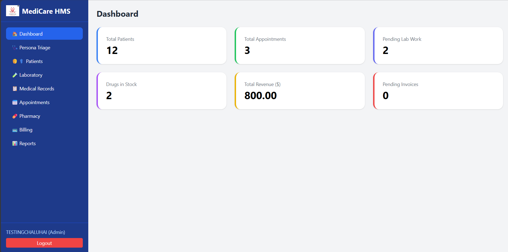
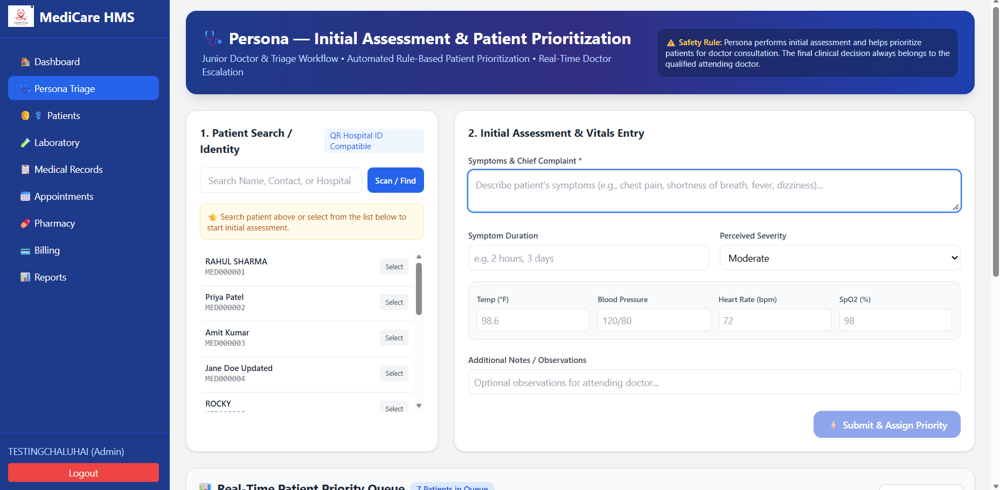
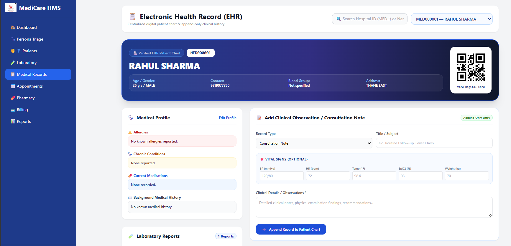
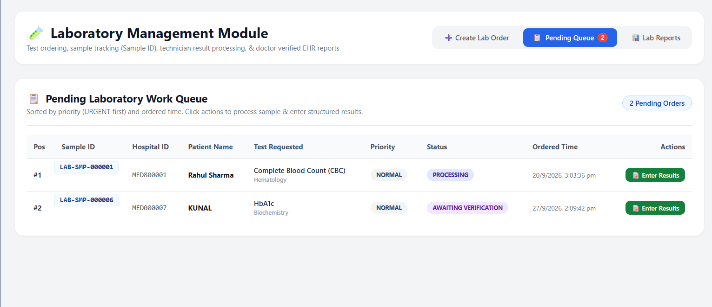
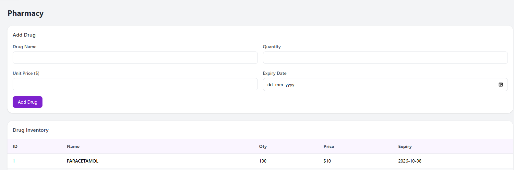
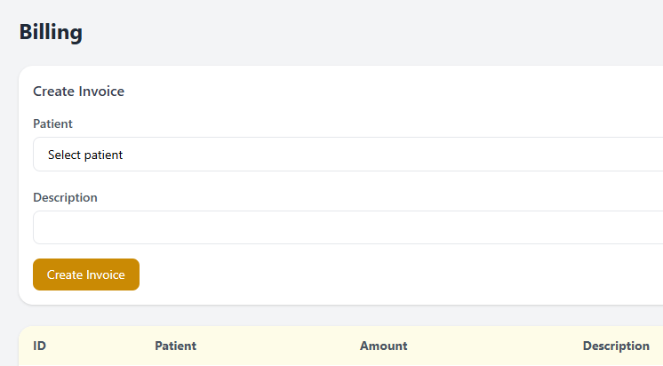
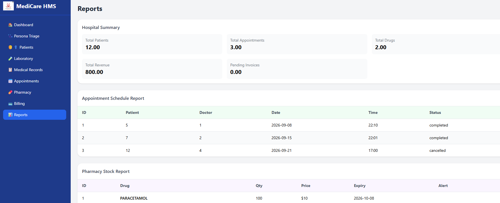
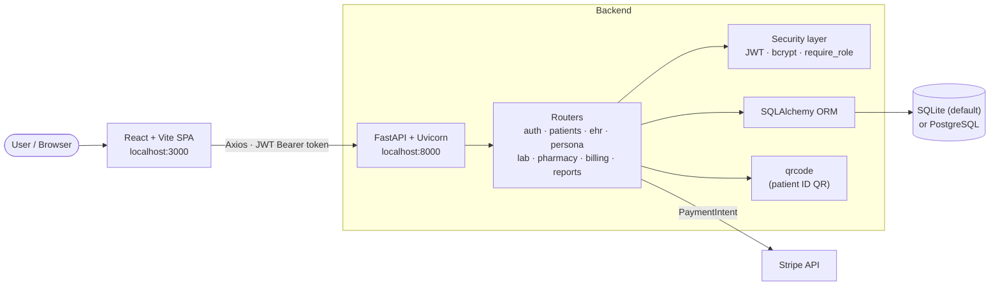

<div align="center">

# 🏥 Care AI – Health Management System

**A role-based hospital management platform covering patient triage, electronic health records, laboratory workflows, pharmacy and billing.**

[](https://react.dev/)
[](https://vitejs.dev/)
[](https://tailwindcss.com/)
[](https://fastapi.tiangolo.com/)
[](https://www.python.org/)
[](https://www.sqlalchemy.org/)
[](#-technology-stack)

[Overview](#-overview) · [Screenshots](#-screenshots) · [Features](#-features) · [Architecture](#-architecture) · [Getting Started](#-getting-started) · [Security](#-security)

<br>


</div>

<br>

## 📑 Table of Contents

- [Overview](#-overview)
- [Screenshots](#-screenshots)
- [Features](#-features)
- [Technology Stack](#-technology-stack)
- [Architecture](#-architecture)
- [Project Structure](#-project-structure)
- [Getting Started](#-getting-started)
- [Environment Configuration](#-environment-configuration)
- [Running Tests](#-running-tests)
- [Security](#-security)
- [Future Enhancements](#-future-enhancements)
- [Author](#-author)

---

## 📌 Overview

**Care AI** is a full-stack health management system built as a final-year computer engineering project. It brings the day-to-day workflows of a small hospital into one application: registering patients with a scannable digital identity, triaging them by urgency, keeping an append-only clinical record, ordering and verifying lab tests, dispensing prescriptions, and billing.

Access is controlled per role, so each user only sees the modules relevant to their job (doctor, nurse, receptionist, pharmacist, lab technician, patient, and so on).

> **A note on the name:** patient triage in this project is **transparent, rule-based logic** (symptom keywords and vital-sign thresholds). The current codebase contains no machine-learning models, LLMs or autonomous agents.

---

## 📸 Screenshots

### 🌐 Website and Landing Pages

<table>
  <tr>
    <td colspan="2" align="center">
      <br>
      <sub><b>Landing page</b> — hero section introducing the platform, with Login and Sign Up entry points.</sub>
    </td>
  </tr>
  <tr>
    <td width="50%" align="center">
      <br>
      <sub><b>Features overview</b> — appointments, billing, pharmacy, patient management, reports and role-based access.</sub>
    </td>
    <td width="50%" align="center">
      <br>
      <sub><b>About Us</b> — mission, vision and team section of the public website.</sub>
    </td>
  </tr>
</table>

### 🔑 Login and Registration

<table>
  <tr>
    <td width="50%" align="center">
      <br>
      <sub><b>Login</b> — JWT-based sign-in.</sub>
    </td>
    <td width="50%" align="center">
      <br>
      <sub><b>Registration</b> — account creation with role selection.</sub>
    </td>
  </tr>
</table>

### 📊 Dashboard and Patient Management

<table>
  <tr>
    <td colspan="2" align="center">
      <br>
      <sub><b>Dashboard</b> — at-a-glance totals for patients, appointments, pending lab work, stock, revenue and invoices.</sub>
    </td>
  </tr>
  <tr>
    <td colspan="2" align="center">
      <br>
      <sub><b>Patient registration</b> — a unique Hospital ID and QR identity are generated automatically.</sub>
    </td>
  </tr>
</table>

### 🔳 QR-Based Patient Identity

<table>
  <tr>
    <td width="50%" align="center">
      <br>
      <sub><b>Patient directory</b> — Hospital ID, QR code, contact details and quick links to the EHR and digital ID.</sub>
    </td>
    <td width="50%" align="center">
      <br>
      <sub><b>Digital ID card</b> — the QR encodes only the Hospital ID; card can be printed or saved.</sub>
    </td>
  </tr>
</table>

### 🩺 Persona-Based Triage and Appointments

<table>
  <tr>
    <td width="50%" align="center">
      <br>
      <sub><b>Persona triage</b> — symptom and vitals entry with patient search, feeding a rule-based priority queue.</sub>
    </td>
    <td width="50%" align="center">
      <br>
      <sub><b>Appointments</b> — add doctors, book appointments and update their status.</sub>
    </td>
  </tr>
</table>

### 📋 Electronic Health Records

<table>
  <tr>
    <td width="50%" align="center">
      <br>
      <sub><b>Patient chart</b> — medical profile and append-only clinical observation entry.</sub>
    </td>
    <td width="50%" align="center">
      <br>
      <sub><b>Clinical timeline</b> — append-only history combining a verified lab report and a rule-based triage review.</sub>
    </td>
  </tr>
</table>

### 🧪 Laboratory Management

<table>
  <tr>
    <td width="50%" align="center">
      <br>
      <sub><b>Create lab order</b> — patient selection, test catalogue and NORMAL / URGENT priority.</sub>
    </td>
    <td width="50%" align="center">
      <br>
      <sub><b>Pending queue</b> — priority-sorted work queue with sample IDs and processing status.</sub>
    </td>
  </tr>
  <tr>
    <td colspan="2" align="center">
      <br>
      <sub><b>Lab reports</b> — draft, awaiting-verification and verified reports with doctor verification.</sub>
    </td>
  </tr>
</table>

### 💊 Pharmacy, Billing and Reports

<table>
  <tr>
    <td width="50%" align="center">
      <br>
      <sub><b>Pharmacy</b> — drug inventory with quantity, price and expiry tracking.</sub>
    </td>
    <td width="50%" align="center">
      <br>
      <sub><b>Billing</b> — invoice creation and invoice list.</sub>
    </td>
  </tr>
  <tr>
    <td colspan="2" align="center">
      <br>
      <sub><b>Reports</b> — hospital summary, appointment schedule and pharmacy stock reports.</sub>
    </td>
  </tr>
</table>

<sub>Screenshots were captured from a local development instance.</sub>

---

## ✨ Features

### 🔐 Authentication & Role-Based Access Control
- Registration and login with **bcrypt**-hashed passwords and **JWT** bearer tokens (1-hour expiry).
- Server-side role checks on API routes via a reusable `require_role(...)` dependency.
- Roles: `admin`, `doctor`, `nurse`, `pharmacist`, `receptionist`, `patient`, plus `persona` (triage) and `lab_technician`.

### 🧑‍⚕️ Patient Management & QR Identity
- Register, search and edit patients; optionally link a patient to a user account for self-service access.
- Auto-generated sequential **Hospital IDs** (`MED000001`, `MED000002`, …).
- A **QR code** (PNG, generated with the `qrcode` library) that encodes **only the Hospital ID**, shown on a printable digital ID card.
- Doctor records and lookups by Hospital ID.

### 🩺 Persona Triage — Rule-Based Prioritisation
- Captures symptoms, duration, perceived severity and vitals (temperature, blood pressure, heart rate, SpO₂).
- Assigns **EMERGENCY / HIGH / NORMAL** priority using explicit keyword and threshold rules, and records a human-readable reason for every decision.
- Real-time priority queue, doctor review and escalation; reviewed assessments are appended to the patient's EHR timeline.
- Every result carries a disclaimer that it is a queueing recommendation, not a diagnosis.

### 📅 Appointments
- Staff can book for any patient; patients with a linked account can book for themselves and cancel their own appointments.
- Status tracking (scheduled, completed, cancelled).

### 📋 Electronic Health Records
- Per-patient profile: allergies, chronic conditions, current medications, background history.
- **Append-only** clinical records (consultation notes, vitals, lab reports) shown as a timeline.
- Role-aware access: receptionists are blocked from clinical data, patients see only their own record, and pharmacists receive a restricted, non-clinical view.

### 🧪 Laboratory
- Built-in catalogue of **12 tests** (CBC, HbA1c, Lipid Profile, LFT, KFT, Thyroid Profile, Dengue, Malaria, and more) with predefined parameters and reference ranges.
- Orders with `NORMAL` / `URGENT` priority and generated sample IDs (`LAB-SMP-000001`).
- Priority-sorted work queue and a status flow: `ORDERED → SAMPLE_COLLECTED → PROCESSING → AWAITING_VERIFICATION → COMPLETED`.
- Structured result entry by technicians, **doctor verification or rejection**, and automatic posting of verified reports to the EHR. Patients can open only their own verified reports.

### 💊 Pharmacy
- Drug inventory management (add, update, list) with quantity, price and expiry.
- Doctors create prescriptions; pharmacists dispense them, which reduces stock and marks the prescription as dispensed.

### 💳 Billing & Reports
- Invoice creation and listing; patients see only their own invoices.
- Server-side **Stripe** PaymentIntent creation when a real `STRIPE_SECRET_KEY` is configured (see [limitations](#known-limitations)).
- Admin summary (patients, appointments, drugs, revenue, pending invoices), appointment report and pharmacy stock report.

### 🧾 Audit Logging
- Triage, laboratory and EHR actions are written to an audit log table.

### Role overview

| Role | Main access |
|------|-------------|
| **admin** | All modules, including the admin summary report |
| **doctor** | Patients, appointments, EHR, prescriptions, lab orders and report verification, triage review |
| **nurse** | Patients, EHR, lab orders, triage |
| **receptionist** | Patients, doctors, appointments, invoices, triage queue (no clinical records) |
| **pharmacist** | Drug inventory, dispensing, stock report, restricted EHR view |
| **patient** | Own appointments, invoices, EHR and verified lab reports |
| **persona** / **lab_technician** | Triage assessments / lab queue and result entry. Supported by the API; not offered on the registration form |

---

## 🧰 Technology Stack

| Layer | Technologies |
|-------|--------------|
| **Frontend** | React 18, JavaScript (JSX), Vite 5, Tailwind CSS 3, React Router 6, Axios, React Hook Form, TanStack Query |
| **Backend** | Python 3.12, FastAPI, Uvicorn, SQLAlchemy 2, Pydantic 2 |
| **Auth** | JWT (`python-jose`), `bcrypt` |
| **Database** | SQLite (default) · PostgreSQL (via `psycopg2-binary`) |
| **Integrations** | Stripe (server-side), `qrcode` for QR generation |
| **Tooling** | Docker / Docker Compose, `python-dotenv` |

---

## 🏗 Architecture



- The frontend reads its API base URL from `VITE_API_URL`; if unset it calls `/api`, which the Vite dev server proxies to `http://localhost:8000`.
- Tables are created automatically at backend start-up (`Base.metadata.create_all`), so no separate migration step is needed for a fresh database.
- Interactive API documentation is generated by FastAPI at `/docs` (Swagger UI) and `/redoc`.

---

## 📁 Project Structure

```text
Care-AI-Health-Management-System/
├── backend/
│   ├── app/
│   │   ├── core/              # config, database, security (JWT / RBAC), audit logging
│   │   ├── models/            # SQLAlchemy models
│   │   ├── routers/           # auth, patients, ehr, persona, lab, pharmacy, billing, reports
│   │   ├── schemas/           # Pydantic request / response schemas
│   │   └── main.py            # FastAPI entry point (app.main:app)
│   ├── tests/
│   │   └── test_laboratory.py
│   ├── test_persona_feature.py
│   ├── .env.example
│   ├── requirements.txt
│   └── Dockerfile · Procfile · runtime.txt · vercel.json
├── frontend/
│   ├── src/
│   │   ├── api/               # Axios client
│   │   ├── components/        # Layout
│   │   ├── context/           # AuthContext
│   │   ├── pages/             # Landing, Login, Register, Dashboard, Persona, Patients,
│   │   │                      # Laboratory, EHR, Appointments, Pharmacy, Billing, Reports
│   │   └── App.jsx · main.jsx
│   ├── .env.example
│   ├── package.json · vite.config.js · tailwind.config.js
│   └── Dockerfile · railway.json · vercel.json
├── screenshots/               # README images
├── docker-compose.yml         # PostgreSQL + backend + frontend
├── render.yaml                # Render service definition for the backend
└── start.sh · git-smart-commit.sh   # helper scripts
```

Deployment configuration files for Render, Vercel and Railway are included, but no hosted demo is linked in this repository.

---

## 🚀 Getting Started

### Prerequisites

- **Python 3.12** and **pip**
- **Node.js 18+** and **npm**
- *(Optional)* Docker Desktop, for the Compose setup

### 1. Clone the repository

```bash
git clone https://github.com/nishant-sharma-99/Care-AI-Health-Management-System.git
cd Care-AI-Health-Management-System
```

### 2. Backend (FastAPI)

<details open>
<summary><b>Windows (PowerShell)</b></summary>

```powershell
cd backend
python -m venv venv
venv\Scripts\Activate.ps1
pip install -r requirements.txt
copy .env.example .env
uvicorn app.main:app --reload
```
</details>

<details>
<summary><b>macOS / Linux</b></summary>

```bash
cd backend
python3 -m venv venv
source venv/bin/activate
pip install -r requirements.txt
cp .env.example .env
uvicorn app.main:app --reload
```
</details>

Before first use, open `backend/.env` and set your own `SECRET_KEY` (see [Environment Configuration](#-environment-configuration)).

The API runs at **http://localhost:8000** with documentation at **http://localhost:8000/docs**.

### 3. Frontend (React + Vite)

Open a second terminal:

```bash
cd frontend
npm install
cp .env.example .env        # Windows: copy .env.example .env
npm run dev
```

The app runs at **http://localhost:3000**.

### 4. First run

1. Open http://localhost:3000/register and create an account, then sign in.
2. As an admin or receptionist, add a doctor under **Appointments** and a patient under **Patients**.
3. Explore triage, EHR, laboratory, pharmacy, billing and reports from the sidebar.

### Docker (optional)

`docker-compose.yml` starts PostgreSQL, the backend and the frontend together:

```bash
cp frontend/.env.example frontend/.env   # Windows: copy frontend\.env.example frontend\.env
docker compose up --build
```

- Frontend: http://localhost:3000
- API docs: http://localhost:8000/docs

The Compose file contains development-only values for the database and `SECRET_KEY`. Change them before using the stack anywhere other than your own machine. To enable Stripe, export `STRIPE_SECRET_KEY` in your shell before starting.

---

## ⚙️ Environment Configuration

Copy the example files and edit the copies. **Never commit the real `.env` files.**

**`backend/.env`**

| Variable | Description | Default / example |
|----------|-------------|-------------------|
| `DATABASE_URL` | SQLAlchemy database URL | `sqlite:///./hms.db` · PostgreSQL: `postgresql://<user>:<password>@<host>:5432/<db>` |
| `SECRET_KEY` | Secret used to sign JWTs. **Generate your own.** | `<your-generated-secret>` |
| `STRIPE_SECRET_KEY` | Stripe **test-mode** secret key. Optional; leave the placeholder to skip Stripe calls. | `<your-stripe-test-key>` |
| `ALLOWED_ORIGINS` | Comma-separated CORS origins. Optional; defaults to `*`. | `http://localhost:3000` |

Generate a secret key:

```bash
python -c "import secrets; print(secrets.token_urlsafe(48))"
```

**`frontend/.env`**

| Variable | Description | Example |
|----------|-------------|---------|
| `VITE_API_URL` | Base URL of the backend API | `http://localhost:8000` |

---

## 🧪 Running Tests

The backend tests are standalone scripts that use FastAPI's `TestClient`. They create users and records in whichever database `DATABASE_URL` points to, so run them against a throw-away database rather than your development data:

```bash
cd backend

# macOS / Linux
DATABASE_URL=sqlite:///./test.db python tests/test_laboratory.py
DATABASE_URL=sqlite:///./test.db python test_persona_feature.py
```

```powershell
# Windows (PowerShell)
$env:DATABASE_URL = "sqlite:///./test.db"
python tests/test_laboratory.py
python test_persona_feature.py
```

Delete `test.db` afterwards. There is currently no frontend test suite.

---

## 🔒 Security

- **Never commit real `.env` files or credentials.** `.gitignore` excludes them; only the `.env.example` files with placeholders belong in the repository.
- **Generate your own `SECRET_KEY`** for every environment and never reuse a value from documentation or examples.
- **Keep API keys private.** Use Stripe *test-mode* keys during development and rotate any key that has been exposed.
- **Use synthetic or anonymised data in public screenshots, demos and issues.** Never publish real patient information.
- **This is an educational project.** It is not a certified clinical system and must not be used to store or process real patient data or to make clinical decisions.

### Known limitations

These are documented honestly so reviewers know the project's scope:

- **Public registration allows choosing any listed role, including `admin`.** Staff accounts should be admin-provisioned before any real use.
- **Some read endpoints only require a logged-in user**, not a specific role (for example the patient list, doctor list and prescription list). Tighten these before handling real data.
- **CORS defaults to `*`** when `ALLOWED_ORIGINS` is not set, and the JWT is kept in the browser's `localStorage`.
- **Stripe is partially integrated:** the server creates a PaymentIntent, but there is no client-side payment confirmation or webhook handling, and the invoice is marked paid immediately.
- **No data is encrypted at rest by the application.** QR codes contain only the Hospital ID.
- `config.py` falls back to a default `SECRET_KEY` if none is set. Always set your own.

---

## 🔮 Future Enhancements

*Planned ideas — none of these are implemented yet.*

- [ ] Restrict registration to non-privileged roles and add admin-managed staff provisioning
- [ ] Enforce role checks on all read endpoints
- [ ] Complete the Stripe flow (client-side confirmation and webhooks)
- [ ] Automated test suite with `pytest` and CI, plus frontend tests
- [ ] Database migrations with Alembic
- [ ] Health checks and hardened containers for deployment
- [ ] Richer analytics dashboards and exportable reports (PDF lab reports, ID cards)
- [ ] Optional AI-assisted features, always with a clinician in the loop

---

## 👤 Author

**Nishant Sharma**

- GitHub: [@nishant-sharma-99](https://github.com/nishant-sharma-99)
- Repository: [Care-AI-Health-Management-System](https://github.com/nishant-sharma-99/Care-AI-Health-Management-System)

<div align="center">
<sub>Built as an educational project. Not intended for clinical use.</sub>
</div>
